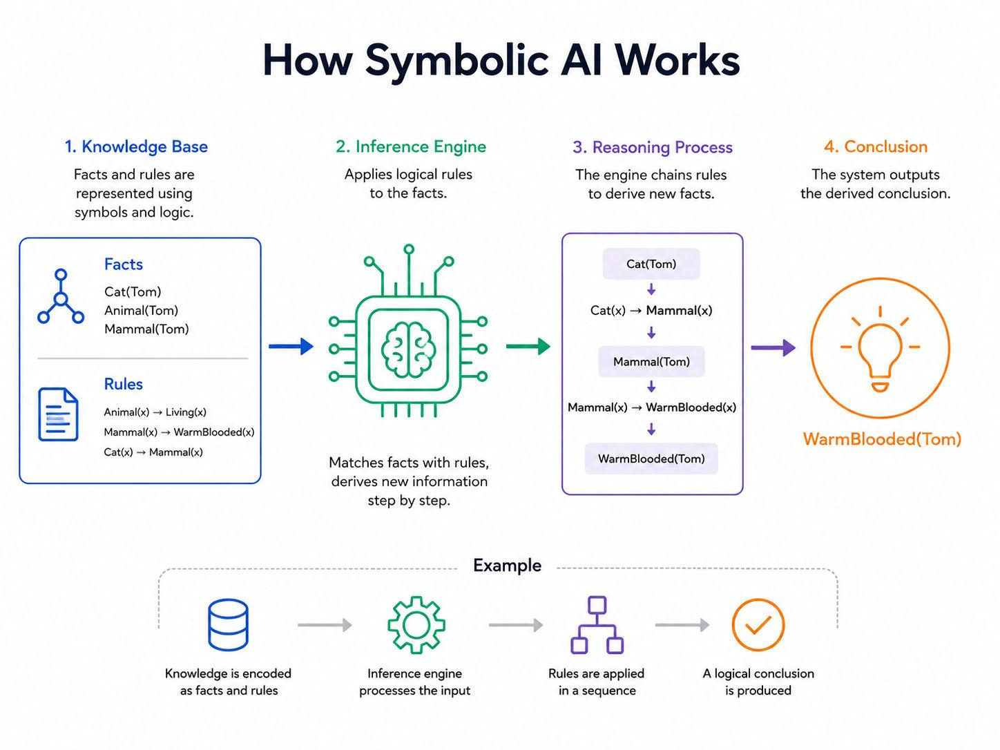
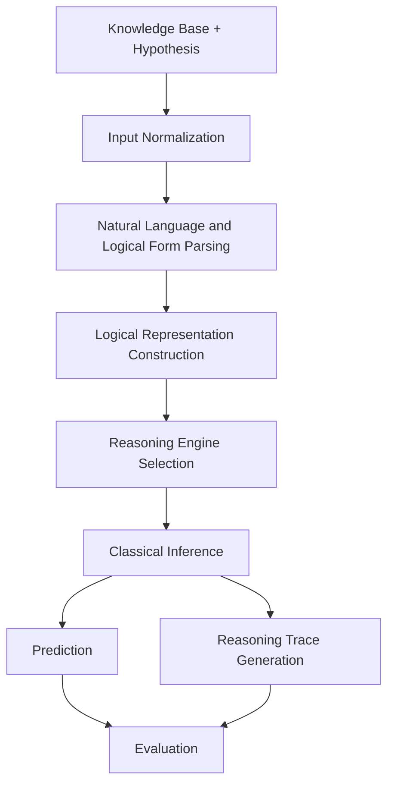
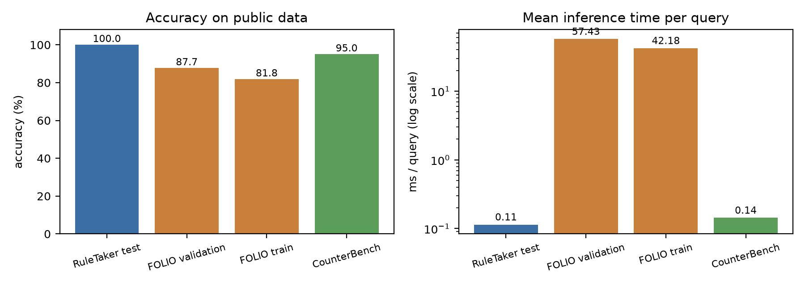
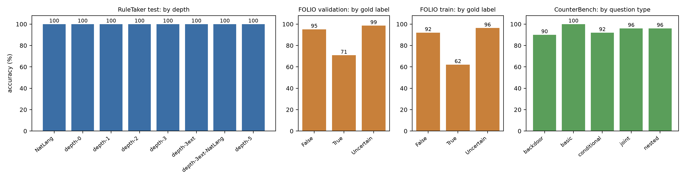
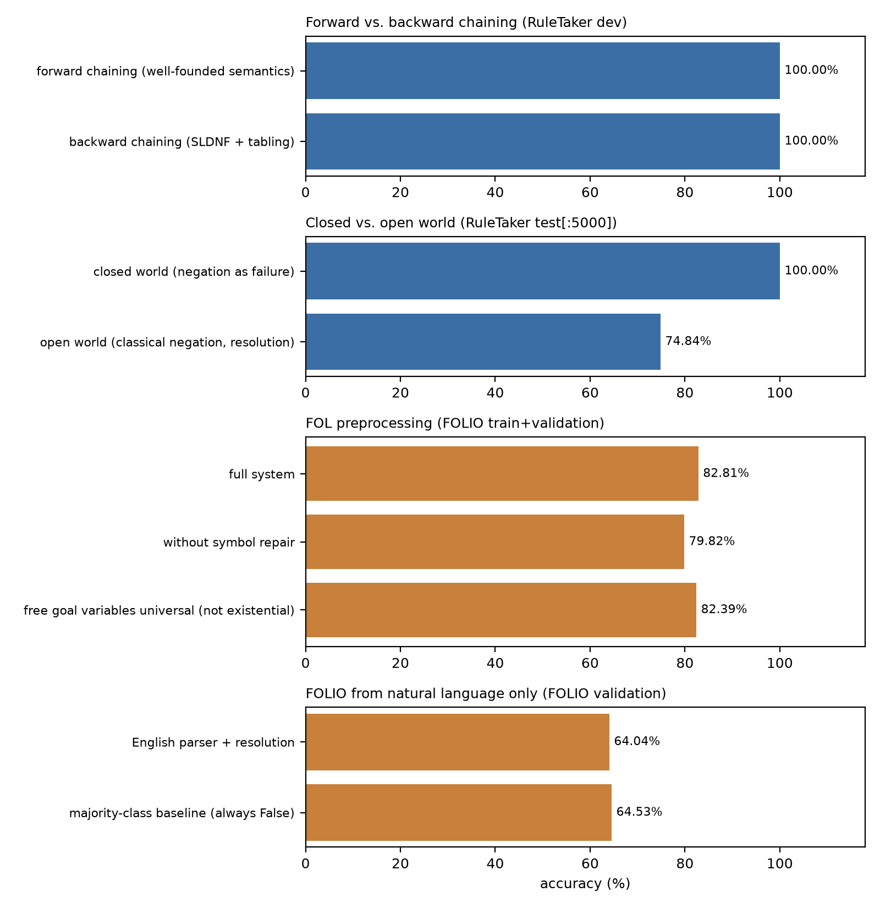
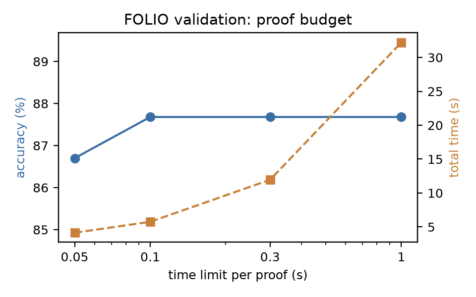

# A Classical Reasoning Agent for Natural-Language Entailment

A modular Python implementation of a classical AI reasoning system that determines whether a hypothesis is supported by a knowledge base. The project combines natural-language processing, logical representation, reasoning-engine selection, symbolic inference, and reasoning-trace generation.

> **Results note:** All numerical results below are taken from the experiment outputs saved in `results/main.csv`, `results/ablations.csv`, `results/breakdown.csv`, and `results/run_info.json`.

---

## Table of Contents

- [Overview](#overview)
- [System Architecture](#system-architecture)
- [Reasoning Pipeline](#reasoning-pipeline)
- [Repository Structure](#repository-structure)
- [Datasets](#datasets)
- [Experimental Results](#experimental-results)
- [Visualizations](#visualizations)
- [Installation](#installation)
- [Running Experiments](#running-experiments)
- [Testing and Code Quality](#testing-and-code-quality)
- [Submission Artifacts](#submission-artifacts)
- [Reproducibility Notes](#reproducibility-notes)

---

## Overview

The objective of this project is to determine whether a natural-language hypothesis logically follows from a given knowledge base.

Instead of relying on a generative model to directly predict entailment labels, the system uses a multi-stage symbolic reasoning pipeline:

1. Input normalization.
2. Natural-language and logical-form parsing.
3. Logical representation construction.
4. Reasoning-engine selection.
5. Classical inference.
6. Prediction and reasoning-trace generation.

The implementation is modular, with separate components for language processing, logical representation, inference, causal reasoning, and evaluation.

## System Architecture
### Overall design


The system uses a multi-stage architecture:

1. Input normalization.
2. Natural-language and logical-form parsing.
3. Logical representation construction.
4. Reasoning-engine selection.
5. Classical inference.
6. Prediction and reasoning-trace generation.

### Overall pipeline



The architecture routes different input types to corresponding reasoning procedures.

| Input type | Representation | Reasoning approach |
|---|---|---|
| Controlled English | Function-free Horn-style rules | Forward chaining |
| Controlled English with query-directed reasoning | Horn rules and literals | Backward chaining |
| First-order logic | Skolemised clauses | Resolution refutation |
| Causal and counterfactual statements | Boolean/causal structures | Causal reasoning |

## Reasoning Pipeline

### 1. Input normalization

The knowledge base and query are prepared for subsequent processing.

### 2. Natural-language and logical-form parsing

Natural-language statements and logical-form inputs are processed into representations suitable for symbolic reasoning.

### 3. Logical representation construction

Statements are converted into logical structures, rules, clauses, or causal representations.

### 4. Reasoning-engine selection

The system selects a reasoning procedure according to the input representation and query.

### 5. Classical inference

The system applies symbolic inference procedures. The implementation includes Datalog-style reasoning and proof procedures, while the saved experiments evaluate forward chaining, backward chaining, and resolution-related configurations.

### 6. Prediction and reasoning trace generation

The system produces predictions and provides utilities for inspecting reasoning traces.

---

## Repository Structure

```text
classical-ai-reasoning-agent/
│
├── data/
│   ├── raw/
│   │   ├── counterbench/
│   │   ├── folio/
│   │   └── ruletaker/
│   │
│   ├── processed/
│   │   ├── counterbench/
│   │   ├── folio/
│   │   └── ruletaker/
│   │
│   └── samples/
│
├── experiments/
│   ├── ablations.py
│   ├── evaluate_all.py
│   ├── inspect_datasets.py
│   ├── make_figures.py
│   ├── preview_datasets.py
│   ├── save_results.py
│   └── show_traces.py
│
├── legacy_scaffold/
│   ├── experiments/
│   ├── src/
│   └── tests/
│
├── notebooks/
│
├── results/
│   ├── ablations.csv
│   ├── breakdown.csv
│   ├── errors.csv
│   ├── main.csv
│   ├── run_info.json
│   │
│   └── figures/
│       ├── ablations.png
│       ├── accuracy.png
│       ├── breakdown.png
│       └── budget.png
│
├── src/
│   └── reasoning_agent/
│       ├── __init__.py
│       ├── agent.py
│       ├── causal.py
│       ├── datalog.py
│       ├── data.py
│       ├── english.py
│       ├── evaluate.py
│       ├── logic.py
│       └── prover.py
│
├── submission/
│   ├── README.txt
│   ├── reasoning_agent.ipynb
│   └── submission.csv
│
├── tests/
│   ├── test_agent.py
│   ├── test_causal.py
│   ├── test_datalog.py
│   ├── test_english.py
│   └── test_logic_and_prover.py
│
├── tools/
│   └── build_notebook.py
│
├── .gitignore
├── .python-version
├── pyproject.toml
└── uv.lock
```

### Main implementation modules

| Module | Responsibility |
|---|---|
| `agent.py` | Main reasoning-agent interface and orchestration |
| `english.py` | Natural-language processing |
| `logic.py` | Logical representation and operations |
| `datalog.py` | Datalog-style rules and reasoning |
| `prover.py` | Proof and inference procedures |
| `causal.py` | Causal reasoning |
| `data.py` | Dataset loading and data utilities |
| `evaluate.py` | Evaluation functionality |

The active implementation is located in `src/reasoning_agent/`. The `legacy_scaffold/` directory retains the earlier implementation scaffold.

---

## Datasets

The project evaluates the reasoning system using three public benchmarks.

### RuleTaker

RuleTaker evaluates reasoning over rule-based knowledge bases. The saved experiment results include the test split and development split.

### FOLIO

FOLIO evaluates logical reasoning involving natural-language statements and first-order logic. The recorded results include training and validation evaluations.

### CounterBench

CounterBench evaluates reasoning involving counterfactual questions, including basic, conditional, joint, nested, and backdoor question types.

The repository separates data into:

- `data/raw/` — raw dataset storage.
- `data/processed/` — processed dataset storage.
- `data/samples/` — sample data.

Dataset inspection utilities are available in `experiments/inspect_datasets.py` and `experiments/preview_datasets.py`.

---

## Experimental Results

The following results are taken directly from the saved experiment CSV files.

### 1. Main Evaluation Results

| Dataset | Correct | Total | Accuracy | Total time (s) | Time/query (ms) |
|---|---:|---:|---:|---:|---:|
| RuleTaker test | 151,911 | 151,911 | **100.00%** | 17.339 | 0.1141 |
| FOLIO validation | 178 | 203 | **87.68%** | 11.659 | 57.4321 |
| FOLIO train | 819 | 1,001 | **81.82%** | 42.218 | 42.1757 |
| CounterBench | 1,140 | 1,200 | **95.00%** | 0.172 | 0.1432 |
| **Overall** | **154,048** | **154,315** | **99.83%** | **71.387** | **0.4626** |

The system achieves an aggregate recorded accuracy of **99.83%** across 154,315 evaluated examples.

The dataset-wise results show:

- 100% accuracy on the recorded RuleTaker test evaluation.
- 87.68% accuracy on FOLIO validation.
- 81.82% accuracy on FOLIO training data.
- 95.00% accuracy on CounterBench.

The aggregate accuracy should be interpreted alongside the individual dataset results because the datasets differ in size and evaluation characteristics.

### 2. Ablation Studies

Ablation experiments investigate the contribution and behavior of different reasoning configurations.

#### 2.1 Forward vs. Backward Chaining

| Reasoning strategy | Dataset | Queries | Accuracy | Time (s) |
|---|---|---:|---:|---:|
| Forward chaining (well-founded semantics) | RuleTaker dev | 75,872 | **100.00%** | 7.722 |
| Backward chaining (SLDNF + tabling) | RuleTaker dev | 75,872 | **100.00%** | 6.015 |

Both strategies achieve 100% accuracy in the recorded experiment. Backward chaining completes the evaluated queries in less time in this run.

#### 2.2 Closed-World vs. Open-World Assumption

| Setting | Dataset | Queries | Accuracy | Time (s) |
|---|---|---:|---:|---:|
| Closed world (negation as failure) | RuleTaker test, first 5,000 | 5,000 | **100.00%** | 0.737 |
| Open world (classical negation, resolution) | RuleTaker test, first 5,000 | 5,000 | **74.84%** | 1.257 |

The recorded closed-world configuration achieves higher accuracy and lower runtime than the open-world configuration for this evaluated subset.

#### 2.3 Resolution Time Budget

| Time limit per proof | Dataset | Queries | Accuracy | Time (s) |
|---:|---|---:|---:|---:|
| 0.05 s | FOLIO validation | 203 | 86.70% | 4.135 |
| 0.1 s | FOLIO validation | 203 | **87.68%** | 5.753 |
| 0.3 s | FOLIO validation | 203 | **87.68%** | 11.949 |
| 1.0 s | FOLIO validation | 203 | **87.68%** | 32.219 |

Increasing the proof budget from 0.05 seconds to 0.1 seconds improves the recorded accuracy. Larger budgets do not improve the recorded accuracy further in this experiment, although runtime increases.

#### 2.4 First-Order Logic Preprocessing

| Configuration | Dataset | Queries | Accuracy | Time (s) |
|---|---|---:|---:|---:|
| Full system | FOLIO train + validation | 1,204 | **82.81%** | 55.987 |
| Without symbol repair | FOLIO train + validation | 1,204 | 79.82% | 58.060 |
| Free goal variables universal (not existential) | FOLIO train + validation | 1,204 | 82.39% | 54.237 |

The full system records the highest accuracy among these three configurations. Removing symbol repair reduces accuracy from 82.81% to 79.82%.

#### 2.5 FOLIO from Natural Language Only

| Method | Dataset | Queries | Accuracy | Time (s) |
|---|---|---:|---:|---:|
| English parser + resolution | FOLIO validation | 203 | 64.04% | 8.628 |
| Majority-class baseline (always False) | FOLIO validation | 203 | 64.53% | Not recorded |

This comparison records the performance of the natural-language-only configuration against a majority-class baseline.

---

### 3. Dataset Breakdown Analysis

#### 3.1 RuleTaker Test: Reasoning Depth

| Group | Correct | Total | Accuracy |
|---|---:|---:|---:|
| NatLang | 7,793 | 7,793 | 100.00% |
| depth-0 | 17,347 | 17,347 | 100.00% |
| depth-1 | 17,788 | 17,788 | 100.00% |
| depth-2 | 17,741 | 17,741 | 100.00% |
| depth-3 | 17,982 | 17,982 | 100.00% |
| depth-3ext | 23,222 | 23,222 | 100.00% |
| depth-3ext-NatLang | 31,017 | 31,017 | 100.00% |
| depth-5 | 19,021 | 19,021 | 100.00% |

The saved breakdown records 100% accuracy across all listed RuleTaker depth groups.

#### 3.2 FOLIO Validation: Gold-Label Breakdown

| Gold label | Correct | Total | Accuracy |
|---|---:|---:|---:|
| False | 59 | 62 | 95.16% |
| True | 51 | 72 | 70.83% |
| Uncertain | 68 | 69 | 98.55% |

The highest recorded accuracy is for the Uncertain class, while the True class has the lowest accuracy in this breakdown.

#### 3.3 FOLIO Training: Gold-Label Breakdown

| Gold label | Correct | Total | Accuracy |
|---|---:|---:|---:|
| False | 266 | 289 | 92.04% |
| True | 241 | 388 | 62.11% |
| Uncertain | 312 | 324 | 96.30% |

#### 3.4 CounterBench: Question-Type Breakdown

| Question type | Correct | Total | Accuracy |
|---|---:|---:|---:|
| backdoor | 180 | 200 | 90.00% |
| basic | 250 | 250 | 100.00% |
| conditional | 230 | 250 | 92.00% |
| joint | 240 | 250 | 96.00% |
| nested | 240 | 250 | 96.00% |

The basic question category achieves 100% accuracy in the saved results. The backdoor category records the lowest accuracy at 90%.

---

### 4. Runtime and Environment Information

The saved `results/run_info.json` contains the following metadata:

| Field | Recorded value |
|---|---|
| Generated | `2026-10-30T01:28:15` |
| Python version | `3.12.13` |
| Platform | `Linux-7.0.5-arch1-1-x86_64-with-glibc2.44` |
| Processor | `x86_64` |
| RuleTaker split | `test` |
| Ablations | `true` |
| Wall-clock time | `322.3 seconds` |

**Runtime clarification:** `results/main.csv` reports 71.387 seconds as the sum of the dataset evaluation times. `results/run_info.json` separately records 322.3 seconds of wall-clock time for the run. These are different measurements and should not be treated as interchangeable.

---

## Visualizations

All figures are stored in `results/figures/`. The following image paths refer to the actual files in the repository.

### Accuracy Across Datasets



### Dataset Breakdown



### Ablation Study



### Inference Budget



---

## Installation

The development environment recorded for this project uses Python 3.12 and `uv`.

Clone the repository:

```bash
git clone <repository-url>
cd classical-ai-reasoning-agent
```

Install dependencies:

```bash
uv sync --group dev
```

If you do not use `uv`, create a virtual environment:

```bash
python -m venv .venv
source .venv/bin/activate
```

Install the dependencies declared in `pyproject.toml` using your preferred package workflow.

## Running Experiments

Run the complete evaluation workflow:

```bash
uv run python experiments/evaluate_all.py
```

Run ablation experiments:

```bash
uv run python experiments/ablations.py
```

Inspect datasets:

```bash
uv run python experiments/inspect_datasets.py
```

Preview dataset examples:

```bash
uv run python experiments/preview_datasets.py
```

Generate figures:

```bash
uv run python experiments/make_figures.py
```

Save experiment results:

```bash
uv run python experiments/save_results.py
```

Inspect reasoning traces:

```bash
uv run python experiments/show_traces.py
```

Run the scripts from the repository root so relative data and result paths resolve correctly.

## Testing and Code Quality

Run the test suite:

```bash
uv run pytest -q
```

Format the source code:

```bash
uv run ruff format src tests experiments
```

Run lint checks:

```bash
uv run ruff check src tests experiments
```

The active test suite includes tests for:

- Agent behavior.
- Causal reasoning.
- Datalog reasoning.
- English processing.
- Logical representation and proof procedures.

## Submission Artifacts

The `submission/` directory contains the assignment-facing files:

| File | Purpose |
|---|---|
| `reasoning_agent.ipynb` | Executable notebook containing the submission implementation and workflow |
| `submission.csv` | Generated prediction file |
| `README.txt` | Submission-specific instructions |

Refer to the assignment specification for the required prediction CSV schema and final submission procedure.

## Reproducibility Notes

- Run commands from the repository root.
- Preserve the directory structure, especially `data/`, `results/`, and `results/figures/`.
- The numerical results in this README reflect the saved experiment artifacts.
- Re-running experiments may update result CSV files, metadata, and figures.
- Raw dataset files may need to be downloaded or prepared separately.
- `legacy_scaffold/` is retained for reference; the active package is `src/reasoning_agent/`.
- The RuleTaker test result is reproduced as recorded in `results/main.csv`. Interpret benchmark split usage according to the assignment's evaluation rules.

## License and Dataset Attribution

Add the applicable project license and dataset citations/attributions before public release. Follow the original terms of use for each benchmark dataset.
